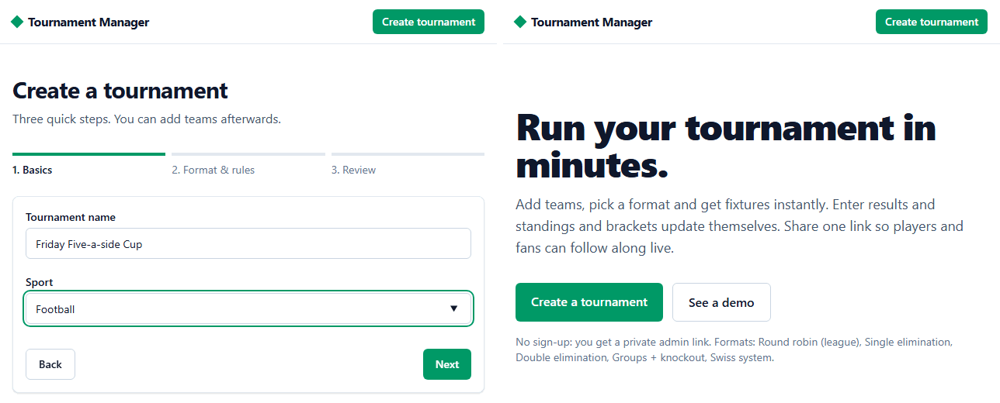
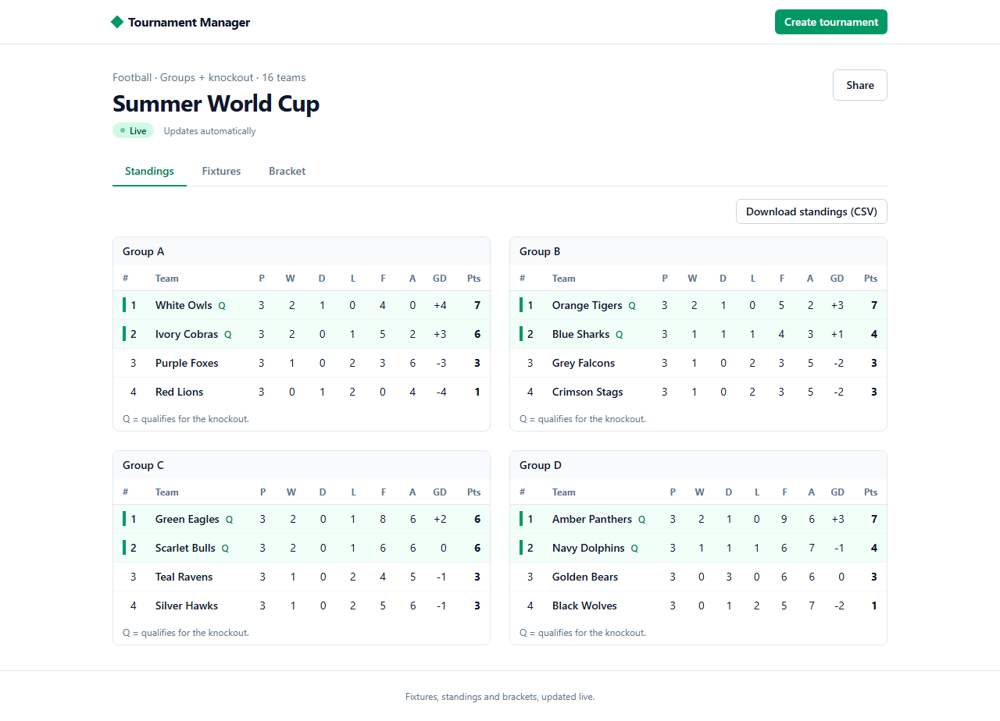
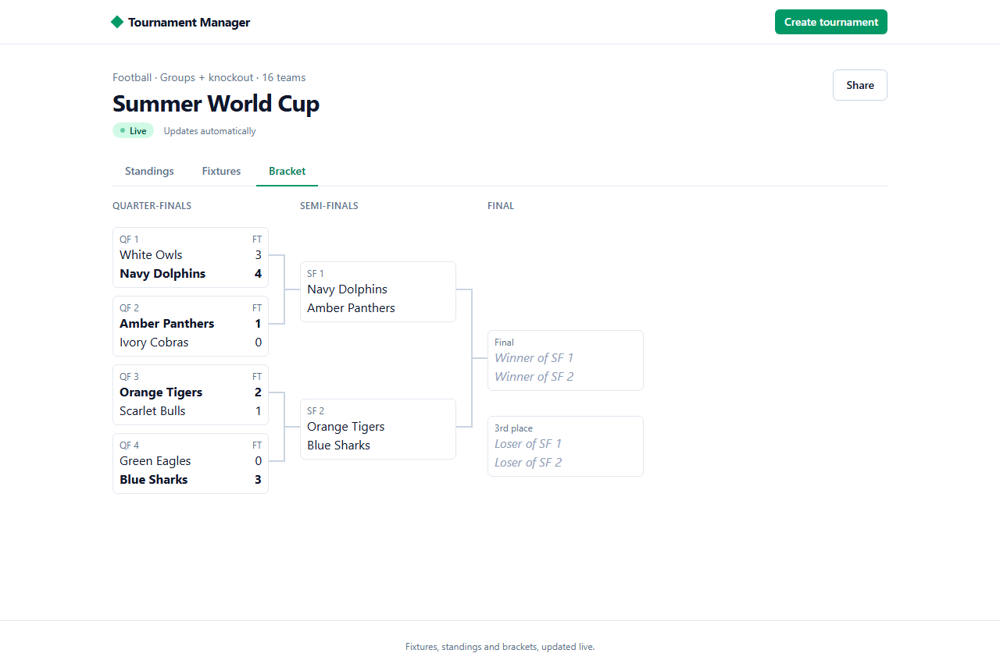
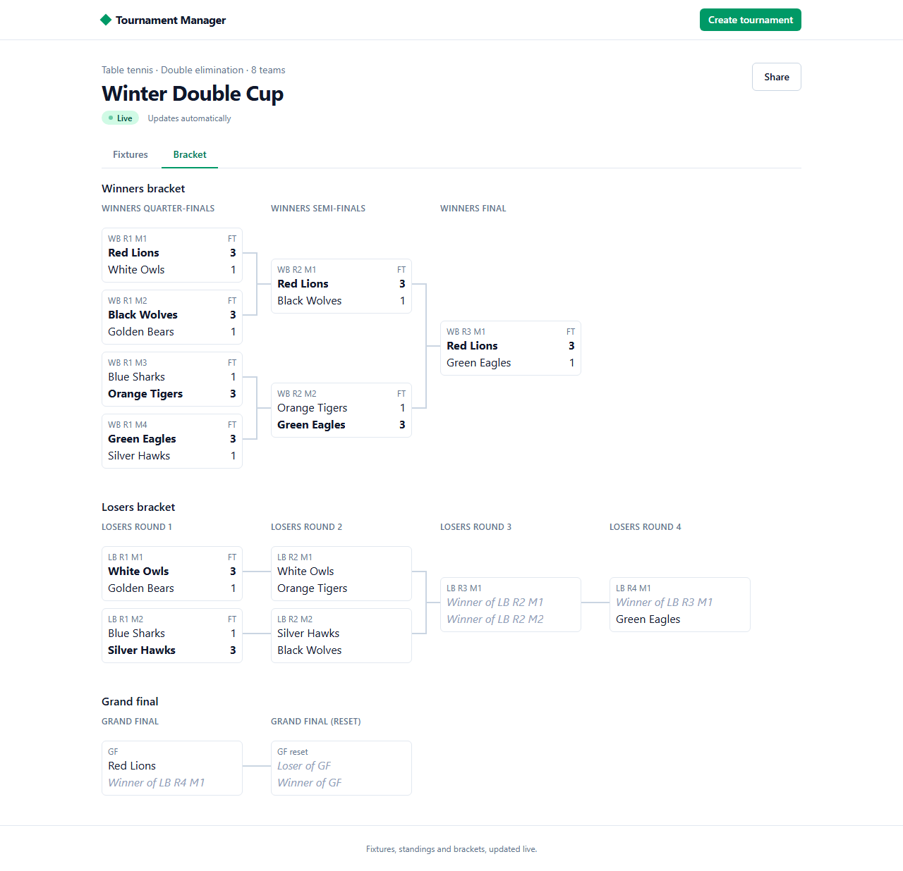
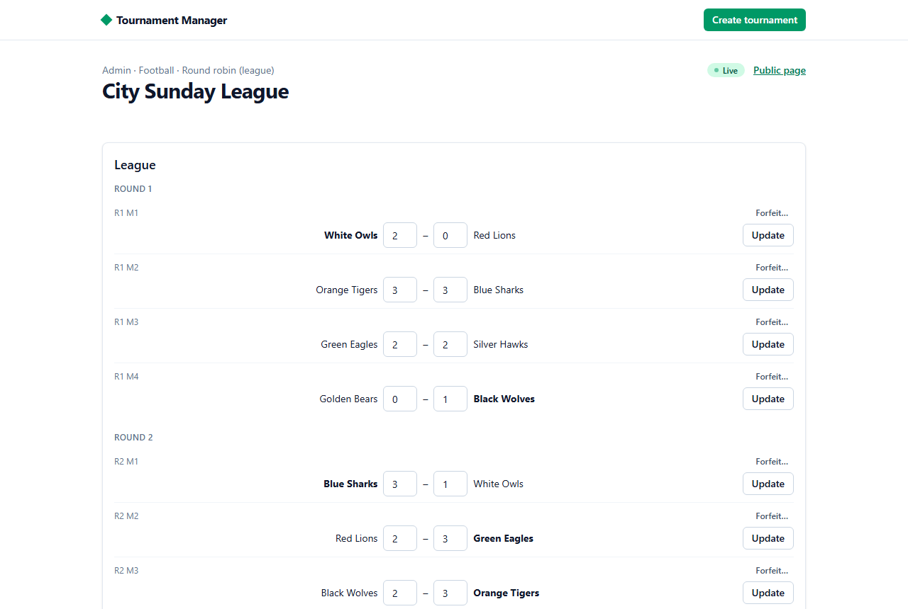
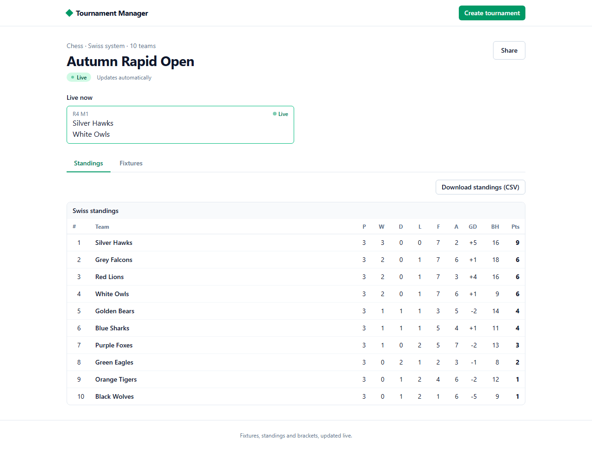
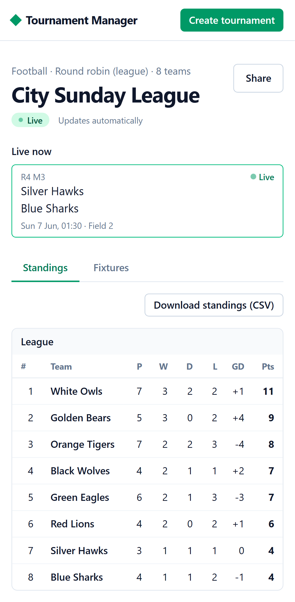
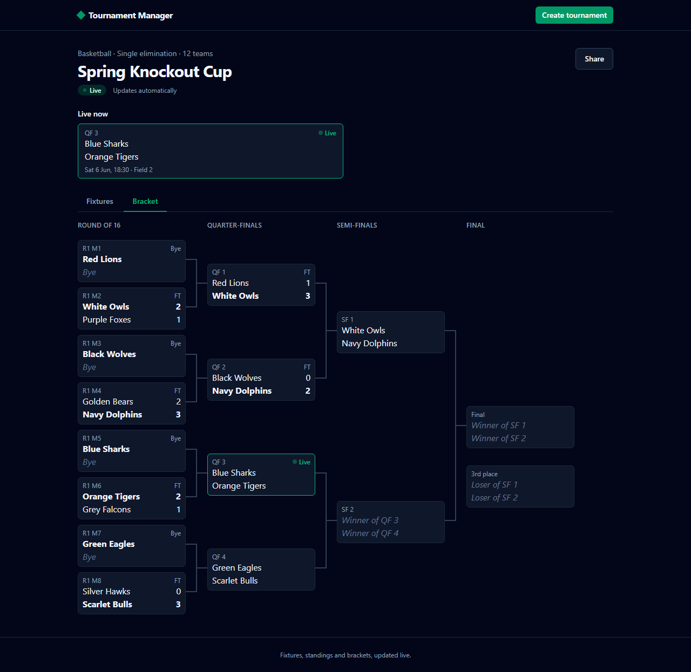
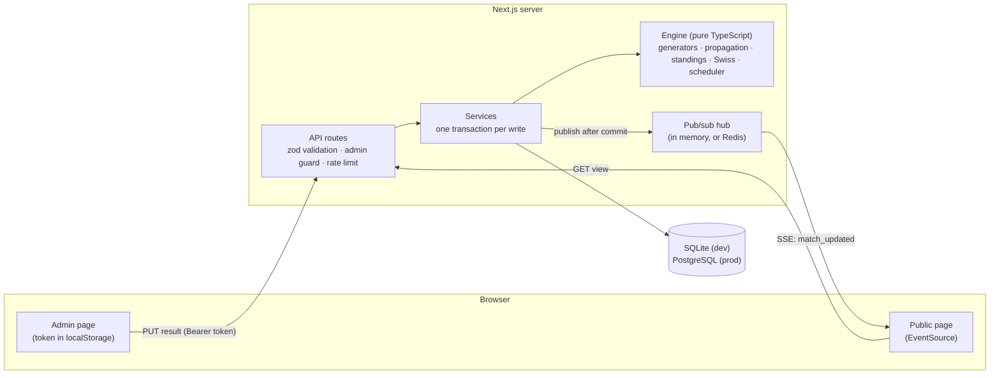

# Tournament Manager

Run a tournament in minutes, for any sport. An organizer creates a tournament, pastes in the
teams and picks a format: round robin, single or double elimination, groups + knockout, or Swiss.
The app draws the fixtures, and every result immediately updates standings and brackets, including
byes, losers brackets, group qualifiers and edits made after the fact. Players and fans follow
along on a public page that updates live, with no sign-up and no reloads.

**Live demo:** not deployed yet (see [NEEDS_YOU.md](NEEDS_YOU.md)). Locally, `npm run db:seed`
creates four demo tournaments: `/t/demo-league`, `/t/demo-cup`, `/t/demo-world-cup` and
`/t/demo-swiss`.



## Features

- **Five formats.** Round robin (one or two legs), single elimination (optional third-place match),
  double elimination (losers bracket, grand final with optional reset), groups + knockout, and
  Swiss (score-group pairing without rematches, byes, Buchholz tiebreak).
- **Fair draws.** Standard bracket seeding, byes for the top seeds, snake-drafted groups,
  cross-group knockout pairings (A1 v B2), round robins with balanced home/away runs.
- **Standings that are never stored.** Always derived from results, with a configurable
  tiebreaker chain: points, head-to-head mini-table (applied recursively), goal difference, goals
  scored, wins, seed, name.
- **Safe edits.** Changing a result re-resolves every later match. If a later match was already
  played by the wrong team, the organizer confirms before it is reset (or the edit is blocked,
  by policy). Simultaneous edits are caught with per-match versions.
- **Real-world results.** Forfeits (walkover with a configurable score), knockout matches decided
  in extra time or on penalties, and matches marked live.
- **Live public page.** Standings, fixtures and a bracket view with connector lines, a "Live now"
  strip, Server-Sent Events with polling fallback, mobile-first layout, dark mode, and link
  previews for chat apps.
- **No sign-up.** Creating a tournament returns a private admin link; only a SHA-256 hash of the
  token is stored.
- **Extras.** An auto-scheduler for venues and time slots (rest gaps, bracket order), and CSV export
  of standings and fixtures.

## Screenshots



| Knockout bracket                                  | Double elimination                                                     |
| ------------------------------------------------- | ---------------------------------------------------------------------- |
|  |  |

| Organizer result entry                            | Swiss standings with Buchholz                  |
| ------------------------------------------------- | ---------------------------------------------- |
|  |  |

| Mobile public page                                 | Dark mode                                            |
| -------------------------------------------------- | ---------------------------------------------------- |
|  |  |

Screenshots and the GIF are generated from the seeded demo data with `npm run screenshots` and
`npm run demo-gif`.

## Architecture



- **Engine** (`src/engine/`): pure functions, with no database, network, clock or unseeded
  randomness. Brackets are a graph of matches whose slots point at sources ("winner of match X",
  "group A, 1st"). `propagate` resolves them in dependency order and reports results that an edit
  invalidates.
- **Services** (`src/server/services/`): load, call the engine, persist in one transaction, then
  notify viewers.
- **API** (`src/app/api/`): thin handlers that validate with zod, authorize, call a service.
- **UI** (`src/app`, `src/components`): server-rendered pages hydrated into live client components.
  The admin page previews fixtures in the browser with the same engine code.

Further reading: [ARCHITECTURE](docs/ARCHITECTURE.md), [DESIGN](docs/DESIGN.md),
[CODE_TOUR](docs/CODE_TOUR.md), [INTERVIEW_NOTES](docs/INTERVIEW_NOTES.md),
[DEPLOYMENT](docs/DEPLOYMENT.md).

## Tech stack

| Layer      | Choice                                                                           |
| ---------- | -------------------------------------------------------------------------------- |
| Language   | TypeScript (strict, `noUncheckedIndexedAccess`)                                  |
| Framework  | Next.js 15 (App Router), React 19                                                |
| UI         | Tailwind CSS v4, small hand-written accessible components                        |
| Data       | Prisma 6: SQLite in development, PostgreSQL in production                        |
| Validation | zod, shared by API and forms                                                     |
| Real-time  | Server-Sent Events; Redis pub/sub across instances (`ioredis`, optional)         |
| Testing    | Vitest + fast-check (property-based), Playwright, embedded PostgreSQL            |
| Deploy     | Vercel + Neon (configured, see [DEPLOYMENT](docs/DEPLOYMENT.md)), GitHub Actions |

## Getting started

Requires Node.js 20 or later.

```bash
npm install            # also runs `prisma generate`
cp .env.example .env   # DATABASE_URL for the local SQLite file
npm run db:migrate     # create the local database
npm run db:seed        # optional: four demo tournaments (prints their admin links)
npm run dev            # http://localhost:3000
```

Create a tournament at `/new`, save the admin link it shows, add teams, start, and enter results.
Open the public link in another window to watch it update.

## Testing

| Command                              | What runs                                                                                         |
| ------------------------------------ | ------------------------------------------------------------------------------------------------- |
| `npm test`                           | 305 unit and integration tests (Vitest; each integration file gets a fresh SQLite database)       |
| `npm run test:cov`                   | The same with coverage; CI fails if engine coverage drops below 90%                               |
| `npm run test:pg`                    | The server integration suites against a real, throwaway PostgreSQL 17 (production migrations)     |
| `npm run test:e2e`                   | Playwright on a production build, desktop and mobile (run `npx playwright install chromium` once) |
| `npm run lint` / `npm run typecheck` | ESLint / `tsc --noEmit`                                                                           |

Measured on the final code: **305 tests passing, 10/10 E2E runs, engine coverage 99.9% of lines
and 96.3% of branches** (all code: 97.6% lines). Highlights:

- **Property-based tests** (fast-check) for the invariants that matter:
  - every pair meets exactly once per leg;
  - seeds 1 and 2 can only meet in the final;
  - double elimination knocks every team out after exactly two losses;
  - Swiss never repeats a pairing;
  - propagation is idempotent;
  - the scheduler never double-books;
  - CSV escaping round-trips.
- **Every API route** is tested for success, bad input, missing or wrong token and state conflicts;
  a test fails if a route is added without tests.
- **A two-browser E2E test** proves a result entered by the organizer appears on a viewer's open page
  without a reload.

## Other scripts

| Command                | What it does                                                    |
| ---------------------- | --------------------------------------------------------------- |
| `npm run db:migrate`   | Apply Prisma migrations in development                          |
| `npm run db:seed`      | Create or replace the demo tournaments                          |
| `npm run db:pg:schema` | Regenerate the production PostgreSQL schema from the SQLite one |
| `npm run build:prod`   | Production build against PostgreSQL (used by Vercel)            |
| `npm run screenshots`  | Regenerate `docs/screenshots/` from seeded demo data            |
| `npm run demo-gif`     | Re-record `docs/demo.gif`                                       |

## API

JSON over REST. Write endpoints need `Authorization: Bearer <adminToken>`. Errors look like
`{ "error": { "code", "message", "details?" } }` with a matching HTTP status.

| Method | Path                                    | Auth                | Purpose                                                                                |
| ------ | --------------------------------------- | ------------------- | -------------------------------------------------------------------------------------- |
| POST   | `/api/tournaments`                      | none (rate-limited) | Create; returns `{ slug, adminToken }`                                                 |
| GET    | `/api/t/:slug`                          | none                | Public view: teams, matches, derived standings                                         |
| GET    | `/api/t/:slug/events`                   | none                | Server-Sent Events: `match_updated`, `tournament_updated`                              |
| POST   | `/api/t/:slug/teams`                    | admin               | Add teams `{ names: [] }`                                                              |
| DELETE | `/api/t/:slug/teams/:teamId`            | admin               | Remove a team (before start)                                                           |
| PUT    | `/api/t/:slug/teams/order`              | admin               | Reseed `{ teamIds: [] }`                                                               |
| POST   | `/api/t/:slug/start`                    | admin               | Generate fixtures and lock teams                                                       |
| PUT    | `/api/t/:slug/matches/:matchId/result`  | admin               | `{ homeScore, awayScore, decidedBy?, winnerTeamId?, expectedVersion?, confirmReset? }` |
| PUT    | `/api/t/:slug/matches/:matchId/forfeit` | admin               | `{ teamId }` forfeits; the opponent wins by walkover                                   |
| PUT    | `/api/t/:slug/matches/:matchId/status`  | admin               | Mark a match `LIVE` or back to `SCHEDULED`                                             |
| POST   | `/api/t/:slug/schedule`                 | admin               | Auto-schedule `{ venues, startTime, slotMinutes, minRestSlots }`                       |

## Design decisions

- **Derive, don't store.** Standings are computed from results on every read, so they can never
  disagree with the results.
- **Sources instead of hard-coded brackets.** Each match declares where its participants come
  from. One propagation function handles byes, losers brackets, group qualifiers, the grand-final
  reset and edits after the fact.
- **Admin links instead of accounts.** No sign-up friction. Tokens are hashed and compared in
  constant time, and write endpoints are rate-limited.
- **SSE instead of WebSockets.** Viewers only receive. On an event they refetch the whole view,
  which is simple and always consistent, even after missed events.
- **Swiss rounds paired on demand.** Each round is paired when the previous one finishes, with a
  backtracking search that guarantees no rematch whenever one is possible.

## Known limitations

Plain statements, so nobody overclaims:

- **Not deployed yet.** The Vercel + Neon configuration exists but has never run in production.
- **Live updates across serverless instances need Redis.** Without `REDIS_URL`, viewers on another
  instance catch up within about 30 seconds. The Redis adapter is tested with `ioredis-mock`, not
  against a live Redis server.
- **The rate limiter is in memory**, so on serverless hosting it is per instance.
- **Swiss pairing is Monrad-style** (neighbours in the ranking), not the FIDE Dutch system;
  colours are balanced only by home-game count. The shoot-out score itself is not stored, only
  its winner.
- **Accounts are not built.** Losing the admin link means losing admin access.
- `npm audit` reports advisories in build-time tooling (Next's bundled PostCSS, the Prisma CLI); the
  fix requires Next 16.

## Roadmap

Done: every phase in [docs/ROADMAP.md](docs/ROADMAP.md), plus Swiss, Redis pub/sub and CSV export
from the stretch list. Next ideas:

- Accounts with a "my tournaments" dashboard.
- A one-click "withdraw team" (walkovers for all remaining matches).
- Penalty shoot-out scores and live in-match scores.
- A distributed rate limiter.

## Project layout

- `src/engine/`: pure tournament logic (generators, propagation, standings, Swiss, scheduler).
- `src/lib/`: code shared by client and server (schemas, result rules, view helpers, CSV).
- `src/server/`: database access, services, pub/sub, API helpers.
- `src/app/`: Next.js pages and API routes. `src/components/`: UI.
- `prisma/`: SQLite schema and migrations, generated PostgreSQL schema and migrations, seed.
- `e2e/`: Playwright tests. `scripts/`: Postgres test runner, screenshots, demo GIF.
- `docs/`: architecture, design, roadmap, deployment, code tour, interview and study notes.
