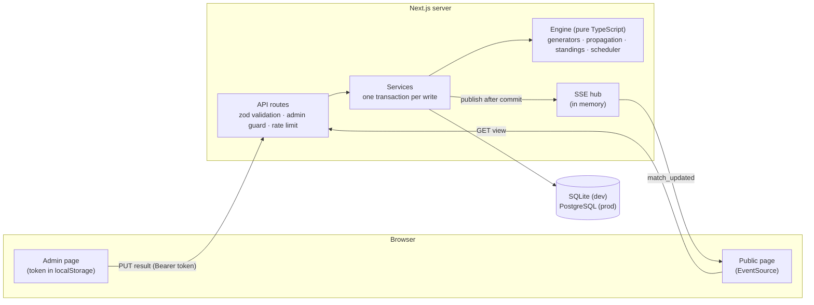

# Tournament Manager

Run a tournament in minutes. Organizers create a tournament, paste in teams and pick a format, and
the app generates the fixtures. Entering a result updates standings and brackets automatically,
and every tournament has a public page that updates live for players and fans.

**Live demo:** _deploy link goes here_ (see [docs/DEPLOYMENT.md](docs/DEPLOYMENT.md)). Locally, run
`npm run db:seed` and open `/t/demo-league`, `/t/demo-cup` or `/t/demo-world-cup`.

| Public standings                             | Bracket                                    | Organizer result entry                   |
| -------------------------------------------- | ------------------------------------------ | ---------------------------------------- |
| _screenshot: docs/screenshots/standings.png_ | _screenshot: docs/screenshots/bracket.png_ | _screenshot: docs/screenshots/admin.png_ |

## Features

- **Four formats**: round robin (one or two legs), single elimination (optional third-place
  match), double elimination (losers bracket, grand final with optional reset), and groups +
  knockout.
- **Fair draws**: standard bracket seeding, byes for the top seeds, snake-drafted groups,
  cross-group knockout pairings (A1 v B2), and round robins with balanced home/away runs.
- **Standings that are never stored**: always derived from results, with a configurable tiebreaker
  chain (points, head-to-head mini-table applied recursively, goal difference, goals scored,
  wins, seed, name).
- **Safe edits**: changing a result re-resolves later matches. If a later match was already
  played by the wrong team, the organizer confirms before it is reset, or the edit is blocked,
  depending on the tournament's policy. Simultaneous edits are caught with per-match versions.
- **Live public page**: standings, fixtures and a bracket view with connector lines, a "Live now"
  strip, Server-Sent Events with a polling fallback, mobile-first layout, dark mode, and link
  previews for chat apps.
- **No sign-up**: creating a tournament returns a private admin link (the token is stored only as
  a SHA-256 hash).
- **Auto-scheduler**: assigns venues and time slots with rest gaps, respecting bracket order.

## Architecture



- **Engine** (`src/engine/`): pure functions, with no database, network, clock or unseeded
  randomness. Brackets are a DAG of matches whose slots point at sources ("winner of match X",
  "group A, 1st"). `propagate` resolves them in topological order and reports results that an edit
  invalidates.
- **Services** (`src/server/services/`): load, call the engine, persist in one transaction, then
  notify viewers.
- **API** (`src/app/api/`): thin handlers that validate, authorize and call a service.
- **UI** (`src/app`, `src/components`): server-rendered pages hydrated into live client
  components. The admin page previews fixtures in the browser with the same engine code.

More detail: [docs/ARCHITECTURE.md](docs/ARCHITECTURE.md), [docs/DESIGN.md](docs/DESIGN.md),
[docs/TECHSTACK.md](docs/TECHSTACK.md), and plain-language answers in
[docs/INTERVIEW_NOTES.md](docs/INTERVIEW_NOTES.md).

## Getting started

Requires Node.js 20 or later.

```bash
npm install            # also runs `prisma generate`
cp .env.example .env   # DATABASE_URL for the local SQLite file
npm run db:migrate     # create the local database
npm run db:seed        # optional: three demo tournaments (prints their admin links)
npm run dev            # http://localhost:3000
```

Create a tournament at `/new`, save the admin link it shows, add teams, start, and enter results.
Open the public link in another window to watch it update.

## Scripts

| Command                              | What it does                                                                                                                   |
| ------------------------------------ | ------------------------------------------------------------------------------------------------------------------------------ |
| `npm run dev`                        | Start the dev server                                                                                                           |
| `npm test`                           | Unit and integration tests (Vitest, temporary SQLite databases)                                                                |
| `npm run test:cov`                   | Tests with coverage (the engine must stay at 90% or above)                                                                     |
| `npm run test:pg`                    | Server integration tests against a real, throwaway PostgreSQL (embedded-postgres) using the production migrations              |
| `npm run test:e2e`                   | Playwright walkthroughs (desktop and mobile) on an isolated production build; run `npx playwright install chromium` once first |
| `npm run lint` / `npm run typecheck` | ESLint / `tsc --noEmit`                                                                                                        |
| `npm run db:migrate`                 | Apply Prisma migrations in development                                                                                         |
| `npm run db:seed`                    | Create or replace the demo tournaments                                                                                         |
| `npm run db:pg:schema`               | Regenerate the production PostgreSQL schema                                                                                    |
| `npm run build:prod`                 | Production build against PostgreSQL (used by Vercel)                                                                           |

## API

JSON over REST. Write endpoints need `Authorization: Bearer <adminToken>`. Errors look like
`{ "error": { "code", "message", "details?" } }` with a matching HTTP status.

| Method | Path                                   | Auth                | Purpose                                                                 |
| ------ | -------------------------------------- | ------------------- | ----------------------------------------------------------------------- |
| POST   | `/api/tournaments`                     | none (rate-limited) | Create; returns `{ slug, adminToken }`                                  |
| GET    | `/api/t/:slug`                         | none                | Public view: teams, matches, derived standings                          |
| GET    | `/api/t/:slug/events`                  | none                | Server-Sent Events: `match_updated`, `tournament_updated`               |
| POST   | `/api/t/:slug/teams`                   | admin               | Add teams `{ names: [] }`                                               |
| DELETE | `/api/t/:slug/teams/:teamId`           | admin               | Remove a team (before start)                                            |
| PUT    | `/api/t/:slug/teams/order`             | admin               | Reseed `{ teamIds: [] }`                                                |
| POST   | `/api/t/:slug/start`                   | admin               | Generate fixtures and lock teams                                        |
| PUT    | `/api/t/:slug/matches/:matchId/result` | admin               | Record/edit `{ homeScore, awayScore, expectedVersion?, confirmReset? }` |
| PUT    | `/api/t/:slug/matches/:matchId/status` | admin               | Mark a match `LIVE` or back to `SCHEDULED`                              |
| POST   | `/api/t/:slug/schedule`                | admin               | Auto-schedule `{ venues, startTime, slotMinutes, minRestSlots }`        |

## Testing

- **Engine**: unit tests plus property-based tests (fast-check) for the invariants that matter:
  - every pair meets exactly once per leg, and no team plays twice in a round;
  - seeds 1 and 2 can only meet in the final;
  - double elimination knocks every team out after exactly two losses;
  - propagation is idempotent;
  - the scheduler never double-books a team or venue.
- **Services and API**: integration tests against a fresh SQLite file per test file. Every route
  is tested for success, validation, auth and state conflicts.
- **End-to-end**: Playwright drives the whole organizer flow, and a two-browser test proves a
  result entered in admin appears on an open public page without a reload.

## Design decisions

- **Derive, don't store.** Standings are computed from results on every read, so they can never
  disagree with the results.
- **Sources instead of hard-coded brackets.** Each match declares where its participants come
  from. One propagation function then handles byes, losers brackets, group qualifiers, the
  grand-final reset, and edits after the fact.
- **Admin links instead of accounts.** Zero sign-up friction. Tokens are hashed and compared in
  constant time, and write endpoints are rate-limited.
- **SSE instead of WebSockets.** Viewers only receive. On an event they refetch the whole view,
  which is simple and always consistent, even after missed events.
- **Draws in knockouts are rejected** rather than adding extra-time or penalty fields (a v1
  simplification).

## What I'd improve next

- Redis pub/sub for the event hub and the rate limiter, so live updates are instant across many
  server instances (see the serverless notes in [docs/DEPLOYMENT.md](docs/DEPLOYMENT.md)).
- Swiss-system pairing, CSV export, and accounts with a "my tournaments" dashboard (the Stretch
  roadmap).
- A forfeit action that awards walkovers for all of a team's remaining matches.
- Penalty shoot-out scores for knockout draws.
- Live scores during a match, not just a live flag.

## Project layout

- `src/engine/`: pure tournament logic (fixtures, standings, brackets, scheduling).
- `src/lib/`: code shared by client and server (schemas, view helpers, stage planning).
- `src/server/`: database access, services, SSE hub, API helpers.
- `src/app/`: Next.js pages and API routes. `src/components/`: UI.
- `prisma/`: SQLite schema and migrations, generated PostgreSQL schema, seed.
- `e2e/`: Playwright tests. `docs/`: architecture, design, roadmap and deployment.
